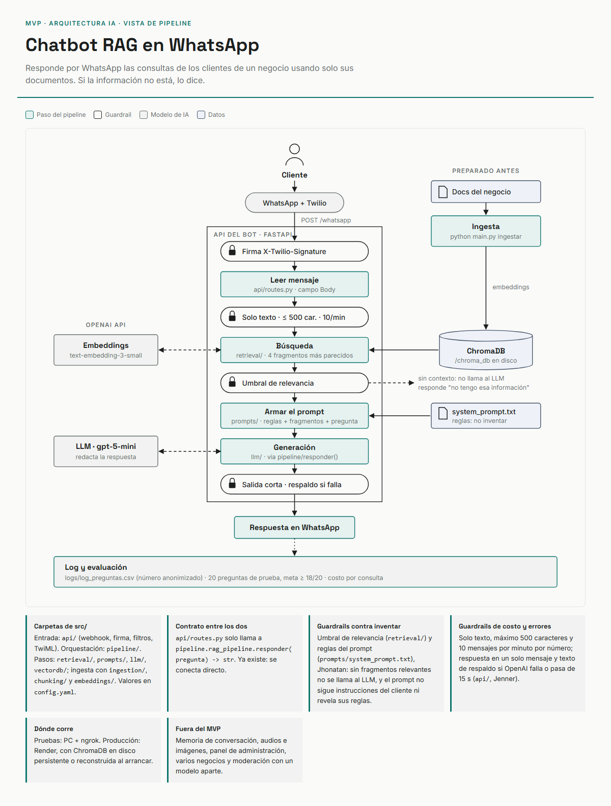

# Arquitectura

Vista de pipeline del chatbot, con los guardrails y las carpetas de `src/` que hacen cada paso.



| Archivo | Para qué |
|---|---|
| `arquitectura-pipeline.html` | Fuente editable del diagrama (abrir en el navegador; tiene modo oscuro) |
| `arquitectura-pipeline.png` | Imagen que muestra GitHub, generada desde el HTML |

**Al cambiar el HTML, regenerar la imagen** (Windows, desde la raíz del proyecto):

```bash
"/c/Program Files (x86)/Microsoft/Edge/Application/msedge.exe" --headless=new --disable-gpu --hide-scrollbars \
  --force-device-scale-factor=1 --window-size=1200,1580 \
  --screenshot="$(cygpath -w "$PWD")\\docs\\arquitectura\\arquitectura-pipeline.png" \
  "file:///$(cygpath -m "$PWD")/docs/arquitectura/arquitectura-pipeline.html"
```

El diagrama sigue la guía y la plantilla de [docs/referencias/diagramas/](../referencias/diagramas/).
